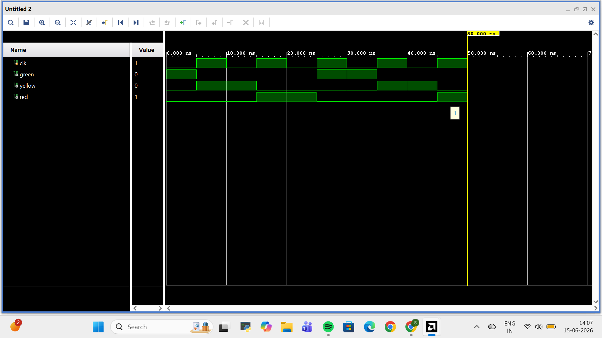

# FSM-Based Traffic Light Controller Using Verilog

## Project Overview

Designed and simulated a Finite State Machine (FSM) based Traffic Light Controller using Verilog HDL.

The controller manages traffic light signals through sequential state transitions synchronized with a clock signal.

## Tools and Technologies

- Verilog HDL
- Xilinx Vivado 2025.1
- Finite State Machine (FSM)
- Digital Design

## Project Files

- `traffic_light_controller.v` – Main traffic light controller design.
- `traffic_light_controller_tb.v` – Testbench used for functional verification.

## Design and Verification

- Designed the traffic light controller using Verilog HDL.
- Used a clock signal to synchronize the controller.
- Verified the output signals using a Verilog testbench.
- Performed simulation using Xilinx Vivado.

## Output Signals

- Green
- Yellow
- Red

## Key Learning Outcomes

- Understanding Finite State Machines.
- Sequential circuit design using Verilog.
- Clock-based state transitions.
- Functional verification using testbenches.

  ## FSM Block Diagram

## Simulation Results

